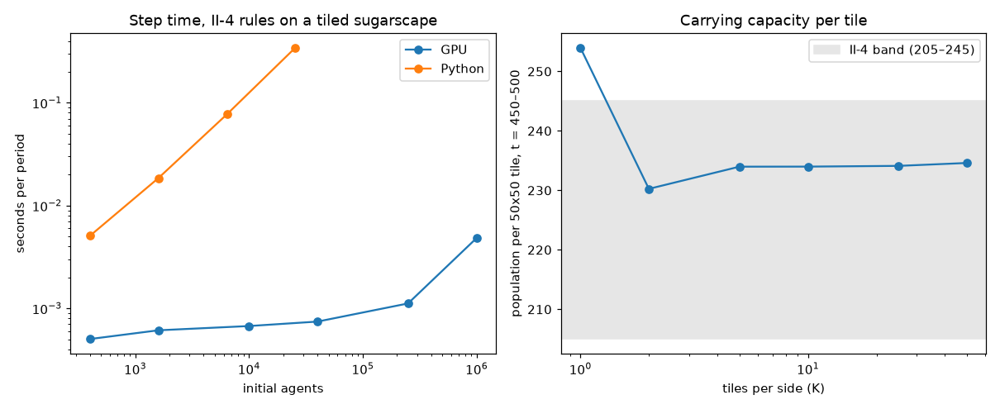

# Sugarscape on FLAME GPU 2

A GPU version of the Chapter II rules of Epstein and Axtell's Sugarscape, built with
[FLAME GPU 2](https://flamegpu.com). It is scored against the book with the Python reference model
[Sugarscape2026](https://github.com/vaatveit/Sugarscape2026). The design is in
[docs/superpowers/specs/2026-10-23-phase1-chapter2-gpu-design.md](docs/superpowers/specs/2026-10-23-phase1-chapter2-gpu-design.md).

## Prerequisites

- An NVIDIA GPU with compute capability 7.5 or newer. Builds target 8.9 (RTX 40xx); change
  `CMAKE_CUDA_ARCHITECTURES` in `scripts/build.cmd` for other GPUs.
- The CUDA 13 toolkit (tested with 13.4). `CUDA_PATH` must point at it.
- Visual Studio with the C++ desktop workload. The build uses the CMake and Ninja that ship with
  Visual Studio, run inside `vcvars64`. `scripts/build.cmd` defaults to
  `C:\Program Files\Microsoft Visual Studio\18\Insiders`; set `VS_ROOT` for another install.
- Python 3.14 for the bridge and tests, plus the Sugarscape2026 Python project. It is found as the
  folder containing this one, which is where it lives inside the Sugarscape2026 repository
  (`flamegpu/`). For a standalone checkout it defaults to `C:\Projects\Sugarscape2026`.
  `SUGARSCAPE_ROOT` overrides both.

FLAME GPU 2 is AGPL-3.0 licensed, and so is the template this project started from. FLAME GPU's
usage statistics (telemetry) are switched off in the build and in every script here.

## Build

```bat
scripts\build.cmd
```

This configures `build\` with FLAME GPU's run-time checks on (`FLAMEGPU_SEATBELTS=ON`) and builds
`build\bin\Release\sugarscape_gpu.exe`. The first build downloads and compiles FLAME GPU
`v2.0.0-rc.5`, which takes a while. The benchmark uses a second build with the checks off:

```bat
scripts\build.cmd build-fast OFF
```

The largest world is fixed when building: CMake option `SUGARSCAPE_MAX_CELLS`, default
2500 × 2500 = 6,250,000 sites.

## Tests

```bat
python -m venv .venv
.venv\Scripts\python -m pip install numpy matplotlib pytest
.venv\Scripts\python -m pytest
```

The tests drive the built program, `build\bin\Release\sugarscape_gpu.exe` (override with
`SUGARSCAPE_GPU_EXE`). Rule tests run the same small scenarios through the GPU program and the Python
model, and require the same results (sugar to within 1e-5). Each scenario is chosen so that the order agents act in cannot
matter.

## Running

One run, from a `run.cfg` of `key = value` lines (the Python `Config` field names; see `--help`):

```bat
build\bin\Release\sugarscape_gpu.exe --config run.cfg --out metrics.csv
```

The registered Chapter II experiments, every seed, written where the Python project's tools can read
them:

```bat
.venv\Scripts\python -m bridge.gpu_run II --jobs 4
.venv\Scripts\python -m bridge.gpu_report --chapter II
```

`gpu_report` scores the GPU results and the Python project's saved `results\` against the same book
targets, and writes `results-gpu\REPORT.md` with both sides and every status that changed.

The scaling benchmark tiles the 50×50 map up to 50 × 50 times (2500 × 2500, about 1M agents):

```bat
.venv\Scripts\python -m bridge.bench
```

It writes `results-gpu\bench.csv` and `results-gpu\bench.png`.

### xl (500 × 500)

xl ([`docs/xl.md`](../docs/xl.md) in the repository root) is the shared workload for comparing the Python, GPU and
Julia implementations. `--xl` runs an experiment's xl version, built by the Python project's own `to_xl`, into
`results-gpu-xl\`:

```bat
.venv\Scripts\python -m bridge.gpu_run II-4 --xl --exe build-fast\bin\Release\sugarscape_gpu.exe
```

Every run, xl or not, also writes `timing.csv` (docs/xl.md's setup, stepping and metrics seconds per seed) and
`machine.txt` (the GPU, driver, CUDA and FLAME GPU versions, the build, and `--jobs`). Time with the fast build,
whose seatbelts are off.

The one-off check of the GPU's xl results against Python's, which writes `docs\validation\xl-chapter2.md`:

```bat
.venv\Scripts\python -m bridge.xl_validate
```

It needs Python's xl results first, about 2–3 hours on the CPU; if they are missing it prints the commands to run.
The results of 2026-10-25 are in [docs/validation/xl-chapter2.md](docs/validation/xl-chapter2.md).

## How the GPU version differs from the Python model

The Python model is sequential: in each period, agents act one at a time in a fresh random order. The
GPU version moves everyone at once. A random priority per agent stands in for the order, and rounds
of atomic claims settle agents that want the same site. The full list of differences is in the
design document. The ones that show in results:

- An agent sees only the positions at the start of the period in the first round. In Python, an agent
  late in the order already sees where earlier agents went.
- A site freed by a death becomes available in the next period.
- Neighbors are counted after everyone has moved. Python counts each agent's neighbors right after
  its own move.

## Results (Phase 1, 2026-10-23)

**Chapter II validation.** The 25 registered experiments, 225 runs, scored against the book's 49
targets:

| | Pass | Near | Fail |
|---|---|---|---|
| Python | 37 | 9 | 3 |
| GPU | 36 | 10 | 3 |

- The GPU's mean is inside the range of Python's seeds for 47 of the 49 targets. The two outside are
  mean neighbors (+7%, a measurement difference the design named) and II-8's pollution ratio (−3%,
  borderline, not yet explained).
- The one status change is a mean on a band's edge: II-5/m3/v8, Python 252.3 against GPU 251.5,
  band from 252.
- Two effects of updating in parallel are measurable: mean neighbors is 7% higher, and early carrying
  capacity about 1% higher.

Details are in [docs/validation/phase1-chapter2.md](docs/validation/phase1-chapter2.md).

**Scaling** (II-4 rules, RTX 4080, `build-fast`, mean of 200 periods; Python 3.14, 50 periods; run as
`python -m bridge.bench --python-tiles 1,2,4,8`):

| World | Agents | GPU ms/period | Python ms/period | Population per 50×50 tile |
|---|---|---|---|---|
| 50 × 50 | 400 | 0.50 | 5.1 | 254.0 |
| 100 × 100 | 1,600 | 0.61 | 18.5 | 230.2 |
| 200 × 200 | 6,400 | — | 77.3 | — |
| 250 × 250 | 10,000 | 0.67 | — | 234.0 |
| 400 × 400 | 25,600 | — | 344.6 | — |
| 500 × 500 | 40,000 | 0.74 | — | 234.0 |
| 1250 × 1250 | 250,000 | 1.12 | — | 234.1 |
| 2500 × 2500 | 1,000,000 | 4.83 | — | 234.6 |

- **Python** grows about linearly with agents, roughly 13 µs per agent. Extrapolated to 1M agents
  that is around 13 s per period, about 2,700× the GPU's 4.8 ms. The extrapolation is a rough figure;
  1M agents was not run in Python.
- **The GPU** is nearly flat up to 250k agents: the device is not yet full, and launch and
  synchronisation overhead dominate.
- **Population per tile** stays within the II-4 band (205–245) at every size except K = 1. That point
  is a single seed of a single tile; the 10-seed means are GPU 237 and Python 233.


